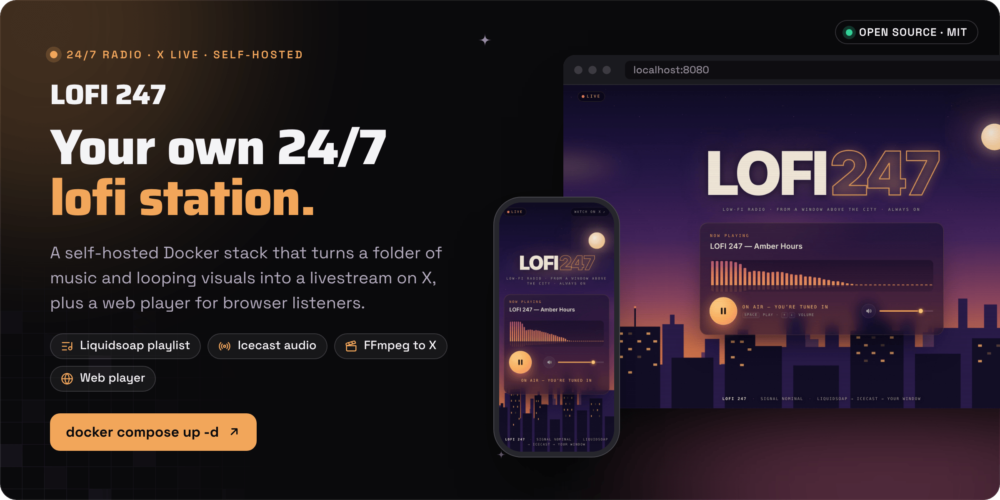
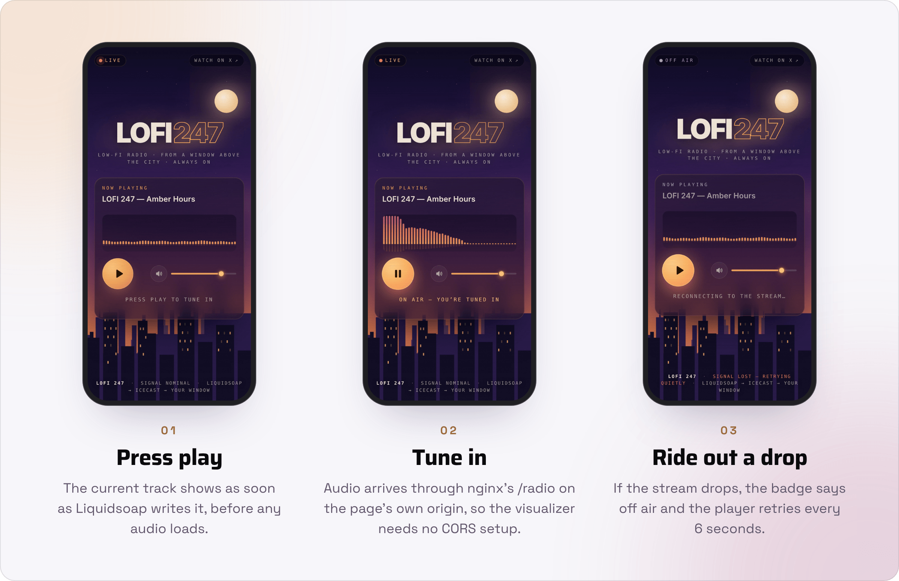
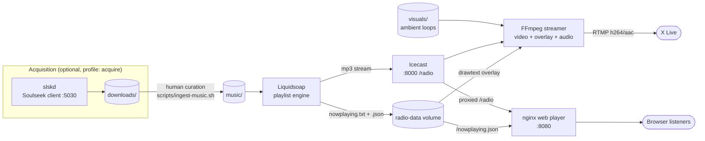
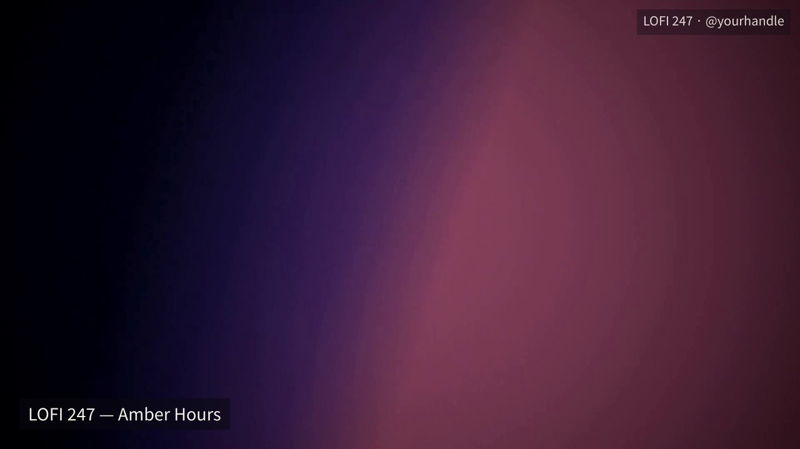
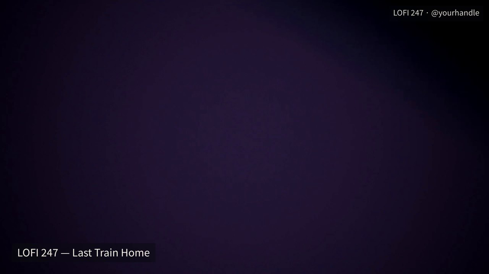
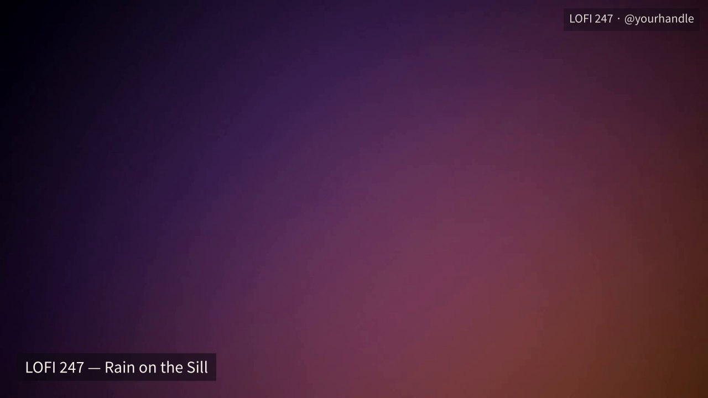

<div align="center">



<br><br>

<a href="#run-it-on-a-vps"></a>&nbsp;&nbsp;
<a href="docs/X-STREAMING.md"></a>&nbsp;&nbsp;
<a href="docs/MUSIC.md"></a>

<br><br>

<a href="https://github.com/operatoruplift/lofi247/actions/workflows/ci.yml"></a>


<a href="LICENSE"></a>

<h3>Low-fi radio from a window above the city. Always on.</h3>

<b>Add music</b> &nbsp;→&nbsp; <b>Add loops</b> &nbsp;→&nbsp; <b>Set the key</b> &nbsp;→&nbsp; <b>Compose up</b> &nbsp;→&nbsp; <b>Go Live on X</b>

<br>

<a href="#how-it-works">How it works</a> &nbsp;·&nbsp;
<a href="#what-viewers-see-on-x">On X</a> &nbsp;·&nbsp;
<a href="#music-and-licensing">Licensing</a> &nbsp;·&nbsp;
<a href="#run-it-on-a-vps">Run it</a> &nbsp;·&nbsp;
<a href="#documentation">Docs</a>

</div>

<br>

<picture>
  <source media="(prefers-color-scheme: dark)" srcset="docs/readme/screens-dark.png">
  
</picture>

<p align="center"><sub>Captured on 30 October 2026 from <code>web/</code> served locally with the same endpoints nginx provides: a starter track stood in for the Icecast stream, and the off-air state was forced by making <code>/radio</code> fail.</sub></p>

**LOFI 247 is a self-hosted, 24/7 lofi radio station that live-streams to X (Twitter), with animated ambient visuals, a now-playing overlay and a browser-based web player.** Point it at a folder of music and a folder of looping background videos, give it an X stream key, and it runs around the clock on a cheap VPS: Liquidsoap shuffles the playlist, Icecast distributes the audio, FFmpeg composites the video and now-playing text and pushes RTMP to X, and nginx serves a visual player for anyone listening in a browser.

Built by Matt ([RVAClassic](https://x.com/rvaclassic), [Operator Uplift](https://operatoruplift.com)) in July 2026.

<br>

## How it works

<picture>
  <source media="(prefers-color-scheme: dark)" srcset="docs/readme/flow-dark.png">
  
</picture>

<table>
  <tr valign="top">
    <td width="33%"><b>No dead air</b><br><sub>If <code>music/</code> is empty or fails, Liquidsoap falls back to the ambient bed in <code>assets/</code>, then to silence, instead of dying. If <code>visuals/</code> is empty, the streamer generates a procedural gradient-and-grain loop.</sub></td>
    <td width="33%"><b>A push that heals itself</b><br><sub>FFmpeg runs inside an infinite retry loop with a 5-second backoff, and a stalled read or write times out after 15 seconds instead of freezing, so network blips and hiccups on X's side recover on their own.</sub></td>
    <td width="33%"><b>Closed by default</b><br><sub>Icecast is reachable only inside the compose network, the slskd web UI binds to 127.0.0.1, FFmpeg errors are scrubbed of the stream key, and the web player is served with a strict Content Security Policy.</sub></td>
  </tr>
</table>

Four always-on services (`icecast`, `liquidsoap`, `streamer`, `web`) plus the optional `slskd` run with `restart: unless-stopped`, next to a one-shot `data-init` that hands the shared `radio-data` volume to Liquidsoap's non-root user. Liquidsoap writes `nowplaying.txt` for the overlay and `nowplaying.json` for the web player into that volume on every track change.

<details>
<summary><b>Full service diagram</b></summary>
<br>



</details>

<p align="center"><sub>Liquidsoap 2.4.5 · Icecast 2.5.0 · FFmpeg on Alpine 3.22 with libx264 and drawtext · nginx 1.30.4 · slskd 0.25.1 (optional) · Docker Compose · vanilla JavaScript web player with Web Audio · GitHub Actions</sub></p>

<br>

## What viewers see on X

<table>
  <tr valign="top">
    <td width="33%"><br><sub><b>00-dusk-drift</b> with Amber Hours</sub></td>
    <td width="33%"><br><sub><b>01-deep-night</b> with Last Train Home</sub></td>
    <td width="33%"><br><sub><b>02-warm-sunset</b> with Rain on the Sill</sub></td>
  </tr>
</table>

<p align="center"><sub>Rendered on 30 October 2026 with the streamer's own filter graph (<code>build_filters</code> in <code>engine/streamer/entrypoint.sh</code>) and encoder flags at the <code>.env.example</code> defaults, 1280×720 at 30 fps, written to a local FLV file instead of X. The handle is the <code>@yourhandle</code> placeholder until you set <code>OVERLAY_HANDLE</code>.</sub></p>

The now-playing line sits in the lower left and the station bug in the top right, both sized from the canvas height so other resolutions stay readable. The streamer prefers a Noto Sans CJK face, so Japanese, Korean and Chinese artist names render instead of empty boxes.

<br>

## Music and licensing

> [!WARNING]
> **Licensing: read this before you go live.**
> Publicly rebroadcasting music on X requires the rights to do so. Streaming tracks you
> do not have a license for **will** get you DMCA takedowns and can get your X account
> suspended. The bundled Soulseek client is included only for acquiring content you
> already have the rights to distribute. See [docs/MUSIC.md](docs/MUSIC.md) for legal
> sourcing options (label agreements, Creative Commons, royalty-free catalogs,
> commissioning artists directly).

<table>
  <tr valign="top">
    <td width="33%"><b>In the repo</b><br><sub>Three starter tracks in <code>music/</code>, <code>amber-hours</code>, <code>rain-on-the-sill</code> and <code>last-train-home</code>: original ambient pieces synthesized for this project and released CC0 1.0. No attribution required.</sub></td>
    <td width="33%"><b>One command for more</b><br><sub><a href="scripts/fetch-cc-music.sh"><code>scripts/fetch-cc-music.sh</code></a> adds a vetted batch of 13 tracks: 7 CC0 (HoliznaCC0, Joel Putman) and 6 CC BY 4.0 (Kevin MacLeod, Ketsa), each checked as real audio, tagged and loudness-normalized.</sub></td>
    <td width="33%"><b>Credit what needs it</b><br><sub>The CC BY tracks require a standing credit where viewers can see it, such as your pinned post or bio. <a href="ATTRIBUTION.md">ATTRIBUTION.md</a> lists every track, source and license, with a ready-to-paste credit block.</sub></td>
  </tr>
</table>

Your own music goes through `scripts/ingest-music.sh`, which normalizes it to -14 LUFS as 320 kbps MP3; tags drive the on-air overlay. The optional slskd client only fills `downloads/`, which never broadcasts directly: a human curates tracks into `music/`.

The three starter loops in `visuals/` (`00-dusk-drift`, `01-deep-night`, `02-warm-sunset`) are 30-second gradient clips in the player's dusk palette, made with the loop recipe in [docs/VISUALS.md](docs/VISUALS.md), which also covers generating scene loops with Seedance 2.0 and normalizing any clip with `scripts/prep-visual.sh`.

<br>

## Status

<table>
  <tr valign="top">
    <td width="16%" align="center"></td>
    <td>Every push to <code>main</code> and every pull request runs shell syntax checks, ShellCheck, a JavaScript parse check and compose validation, then boots the whole stack with a test tone and a dummy RTMP sink and checks the web player, now-playing metadata, audio through <code>/radio</code> and the RTMP push.</td>
    <td width="22%"><a href=".github/workflows/ci.yml">CI workflow</a></td>
  </tr>
  <tr valign="top">
    <td align="center"></td>
    <td>Vercel publishes <code>main</code> to <a href="https://lofi247-gold.vercel.app">lofi247-gold.vercel.app</a>, the repository homepage. The station itself, with its audio, now-playing data and push to X, runs on your own server with Docker.</td>
    <td><a href="https://lofi247-gold.vercel.app">Homepage</a></td>
  </tr>
  <tr valign="top">
    <td align="center"></td>
    <td>Going live is not automatic: once FFmpeg is pushing, you still click <b>Go Live</b> in X Live Studio, and X's 24-hour cap per livestream means rotating the broadcast by hand once a day.</td>
    <td><a href="docs/X-STREAMING.md#6-247-operation-how-restarts-interact-with-x-broadcasts">24/7 on X</a></td>
  </tr>
</table>

<br>

## Run it on a VPS

<table>
  <tr valign="top">
    <td width="33%"><b>Prerequisites</b><br><sub>A VPS with Docker: 2 vCPU and 4 GB RAM comfortably handle 720p30. An X account with X Premium, which RTMP stream keys require. Music you have the rights to broadcast.</sub></td>
    <td width="33%"><b>Read first</b><br><sub><a href="docs/MUSIC.md">docs/MUSIC.md</a> and <a href="ATTRIBUTION.md">ATTRIBUTION.md</a> before anything airs, <a href="docs/VPS-SETUP.md">docs/VPS-SETUP.md</a> for the bootstrap, and <a href="docs/X-STREAMING.md">docs/X-STREAMING.md</a> for the key.</sub></td>
    <td width="33%"><b>What CI proves</b><br><sub>The stack boots, Liquidsoap writes now-playing, audio flows through <code>/radio</code> and FFmpeg pushes RTMP to a test sink. It never touches X.</sub></td>
  </tr>
</table>

On a VPS (Ubuntu 24.04 recommended; [docs/VPS-SETUP.md](docs/VPS-SETUP.md) has the full walkthrough, including the bootstrap script):

```bash
git clone https://github.com/operatoruplift/lofi247.git   # or your fork
cd lofi247
cp .env.example .env
# Fill in: X_RTMP_URL + X_STREAM_KEY (see docs/X-STREAMING.md),
#          ICECAST_SOURCE_PASSWORD, ICECAST_ADMIN_PASSWORD,
#          STATION_NAME, OVERLAY_HANDLE
# No X key yet? Leave X_STREAM_KEY at its placeholder to run in preview mode:
# the web player + audio come up and the streamer stays idle (see below).
nano .env

# Add content. Quickest start: fetch a vetted batch of CC / public-domain
# tracks straight onto the box (credits required: see ATTRIBUTION.md):
./scripts/fetch-cc-music.sh

# Or copy your own library over (run these from your local machine).
# --chmod=F644 forces every copied file world-readable: liquidsoap and the
# streamer run as non-root uids, so a track synced from a tight-umask machine
# silently never airs (all services "Up", ambient bed plays, real tracks don't).
# Details: docs/VPS-SETUP.md#6-getting-music-and-visuals-onto-the-box
rsync -av --chmod=F644 ~/my-lofi-tracks/  user@vps:~/lofi247/music/
rsync -av --chmod=F644 ~/my-loops/        user@vps:~/lofi247/visuals/

# Launch
docker compose up -d

# Watch it come up
docker compose logs -f streamer
./scripts/status.sh
```

Open `http://your-vps:8080` for the web player.

**No X key yet?** Leave `X_STREAM_KEY` at its placeholder (`your-x-stream-key`) and the streamer stays idle in **preview mode**: Icecast and the `:8080` web player still come up, so you can watch the whole stack work before you have X Premium or a real key. Fill the key in when you're ready to broadcast.

Going live is **not** automatic once the encoder connects. When FFmpeg is pushing, X only shows the source as *receiving*: you still have to click **Go Live** in X Live Studio for anything to reach your timeline. The full click path is in [docs/X-STREAMING.md](docs/X-STREAMING.md).

To also run the optional Soulseek client:

```bash
docker compose --profile acquire up -d
```

> [!NOTE]
> "Runs forever" is the VPS side. X caps a single livestream at ~24 h and has no
> broadcast-rotation API, so keeping the channel *visibly* live means a ~60-second
> manual broadcast rotation once a day; see
> [docs/X-STREAMING.md](docs/X-STREAMING.md#6-247-operation-how-restarts-interact-with-x-broadcasts).

<details>
<summary><b>Requirements</b></summary>
<br>

- A VPS with Docker: 2 vCPU / 4 GB RAM comfortably handles 720p30 (see the sizing guide in [docs/VPS-SETUP.md](docs/VPS-SETUP.md))
- An X account with **X Premium** (required for RTMP stream keys)
- Music you have the rights to broadcast
- Optional: ambient video loops (the streamer generates a fallback visual if you have none)

</details>

<details>
<summary><b>Repository layout</b></summary>
<br>

| Path | What it is |
|---|---|
| `docker-compose.yml` | The whole stack: icecast, liquidsoap, streamer, web, slskd (optional), plus the one-shot data-init |
| `docker-compose.ci.yml` | CI-only override: a dummy RTMP sink for the smoke test |
| `.env.example` | Every knob, documented: copy to `.env` and fill in |
| `engine/liquidsoap/radio.liq` | Playlist logic, fallback chain, now-playing writes |
| `engine/streamer/` | Custom FFmpeg container + entrypoint (compositing, overlay, RTMP push, retry loop) |
| `engine/nginx/default.conf` | Web player vhost: static files, `/nowplaying.json`, `/config.json`, `/radio` proxy |
| `engine/nginx/40-lofi-config.sh` | Writes the player's branding config from `STATION_NAME` and `OVERLAY_HANDLE` at start |
| `web/` | Browser player (HTML/CSS/JS, Web Audio visualizer) |
| `music/` | Your curated library: what actually broadcasts |
| `visuals/` | Looping background videos (see [docs/VISUALS.md](docs/VISUALS.md)) |
| `assets/` | The emergency ambient bed, kept outside `music/` so it never enters the playlist |
| `downloads/` | slskd landing zone: **never** broadcast directly |
| `scripts/vps-setup.sh` | Idempotent Ubuntu 24.04 bootstrap (Docker, UFW, dirs) |
| `scripts/status.sh` | One-glance operator status |
| `scripts/fetch-cc-music.sh` | Fetches the vetted CC / CC0 batch into `music/` |
| `scripts/ingest-music.sh` | Curation step: downloads → music |
| `scripts/prep-visual.sh` | Normalize/transcode videos for the streamer |
| `docs/` | The guides listed below |

</details>

<br>

## Documentation

<table>
  <tr valign="top">
    <td width="33%"><b>Set it up</b><br><sub><a href="docs/VPS-SETUP.md">VPS setup</a>: provider sizing and pricing, Ubuntu 24.04 setup, firewall, deploy, updating<br><a href="docs/X-STREAMING.md">Streaming to X</a>: the RTMP URL and stream key, encoder settings, 24/7 broadcast strategy, the Restream fallback</sub></td>
    <td width="33%"><b>Fill it</b><br><sub><a href="docs/MUSIC.md">Music</a>: sourcing legally, the ingest workflow, library conventions<br><a href="docs/VISUALS.md">Visuals</a>: generating ambient loops (Seedance 2.0) and prepping them for the streamer<br><a href="ATTRIBUTION.md">Attribution</a>: every vetted track and the credit it needs</sub></td>
    <td width="33%"><b>Fix it</b><br><sub><a href="TROUBLESHOOTING.md">Troubleshooting</a>: first-run failure modes by symptom, from no audio and tracks not airing to a blank web player and "not live on X"</sub></td>
  </tr>
</table>

<br>

## Credits

Built on the shoulders of excellent open source:
[Liquidsoap](https://www.liquidsoap.info/) ·
[Icecast](https://icecast.org/) ·
[FFmpeg](https://ffmpeg.org/) ·
[nginx](https://nginx.org/) ·
[slskd](https://github.com/slskd/slskd)

Inspired by every lofi girl studying at 2am, everywhere.

## License

The code in this repo is released under the [MIT License](LICENSE), copyright © 2026 operatoruplift. Fork it, run it, modify it; just keep the license and copyright notice.

The MIT License covers **this code only.** The music and visuals you stream through it are a separate matter and remain **your** responsibility to license: see the warning above and [docs/MUSIC.md](docs/MUSIC.md).

<br>

<p align="center"><sub>Code is MIT licensed (see <a href="LICENSE">LICENSE</a>). Music carries its own licenses, listed in <a href="ATTRIBUTION.md">ATTRIBUTION.md</a>.</sub></p>

<p align="center"><sub>Built by <a href="https://rvaclassic.xyz">Matt Sim</a>, founder of <a href="https://operatoruplift.com">Operator Uplift</a>. More builds at <a href="https://github.com/operatoruplift">github.com/operatoruplift</a>. Want one built for your product? <a href="https://cal.com/rvaclassic/15min">Book a 15-minute call</a>.</sub></p>
